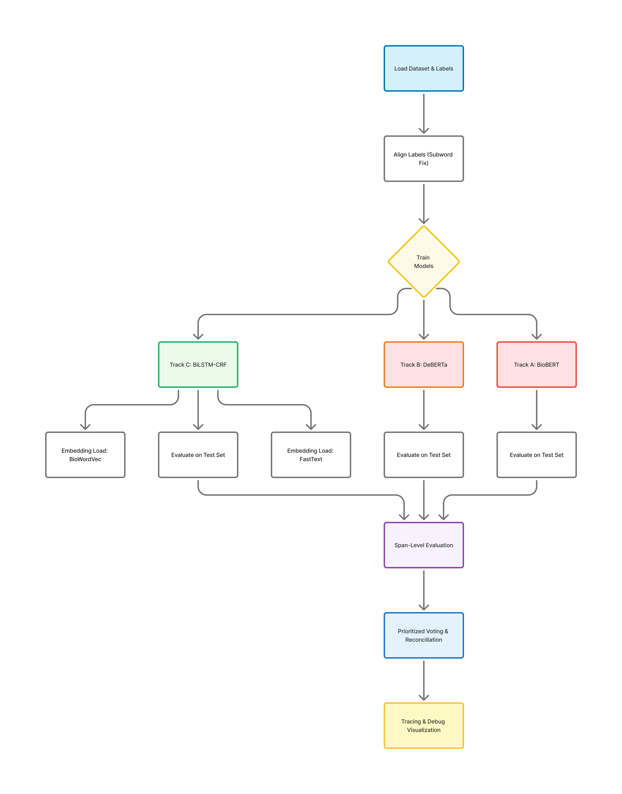

# Biomedical NER: Extracting Chemicals and Diseases from Clinical Literature

I compared four named entity recognition models that tag **chemical** and **disease** mentions in PubMed abstracts. Two are fine-tuned transformers and two are BiLSTM-CRF models with different static embeddings. The comparison uses the BC5CDR corpus and is scored at the span level.



## Results (test set, span-level micro F1, seqeval)

| Track | Model | Embeddings / Checkpoint | Micro F1 |
|---|---|---|---|
| B | DeBERTa-v3-base | `microsoft/deberta-v3-base` | **89.2%** |
| A | BioBERT | `dmis-lab/biobert-base-cased-v1.1` | 88.4% |
| C1 | BiLSTM-CRF | BioWordVec (200d) | 73.8% |
| C2 | BiLSTM-CRF | FastText wiki-news (300d) | 73.3% |

What the results show:
- **Contextual embeddings beat static ones by about 15 F1 points.** The transformers resolve ambiguous and multi-word entities that the BiLSTM-CRF models miss.
- **Chemicals are easier to find than diseases.** Chemicals score about 92% F1 and diseases about 85%, because disease mentions vary more and overlap with general medical terms.
- **Embedding coverage matters for the BiLSTM-CRF.** FastText covers 85.7% of the vocabulary and BioWordVec covers 74.0%. FastText's character n-grams help with drug-name suffixes such as `-idine` and `-acin`.

The full write-up, with per-class precision and recall and error analysis, is in [docs/report.pdf](docs/report.pdf). The notebook also has learning curves and McNemar significance tests.

## Approach

- **Subword label alignment:** the first subword keeps the word's label, and the continuation subwords of a `B-` word become `I-`. Special tokens get the label `-100` so the loss ignores them.
- **Prioritized-vote reconciliation:** subword predictions are merged back into word-level spans, and a `B-` tag takes priority over `I-` tags.
- **Training:** the BiLSTM-CRF models replace padding labels with a valid index and mask them, which makes them compatible with the CRF layer. Every track uses early stopping on validation F1.

## Repository layout

```
biomedical_ner.ipynb   # end-to-end pipeline: data prep, 4 tracks, evaluation, plots
dataset/               # BC5CDR, sentence-split, BIO tags (train/valid/test + label map)
assets/workflow.jpg    # pipeline diagram
docs/report.pdf        # full technical report
```

## Running it

```bash
pip install -r requirements.txt
```

1. The transformer checkpoints download automatically from the Hugging Face Hub.
2. For Tracks C1 and C2, download the embeddings into `./embeddings/`. They are not committed because together they take up about 4 GB:
   - [BioWordVec](https://github.com/ncbi-nlp/BioWordVec), saved as `embeddings/bio_embedding_intrinsic` (word2vec binary)
   - [FastText wiki-news-300d-1M](https://fasttext.cc/docs/en/english-vectors.html), saved as `embeddings/wiki-news-300d-1M.vec`
3. Run `biomedical_ner.ipynb` from top to bottom. A CUDA GPU is strongly recommended.

## Dataset

The data is the [BC5CDR corpus](https://huggingface.co/datasets/tner/bc5cdr) (BioCreative V Chemical Disease Relation): 1,500 PubMed articles annotated for chemicals and diseases and split into sentences.

## Team

Built with Nagraj Venkatesham Vallakati and Swet Vimalkumar Patel.
